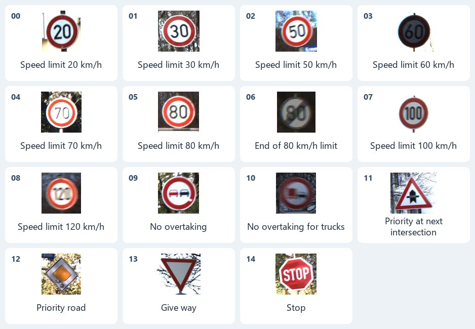
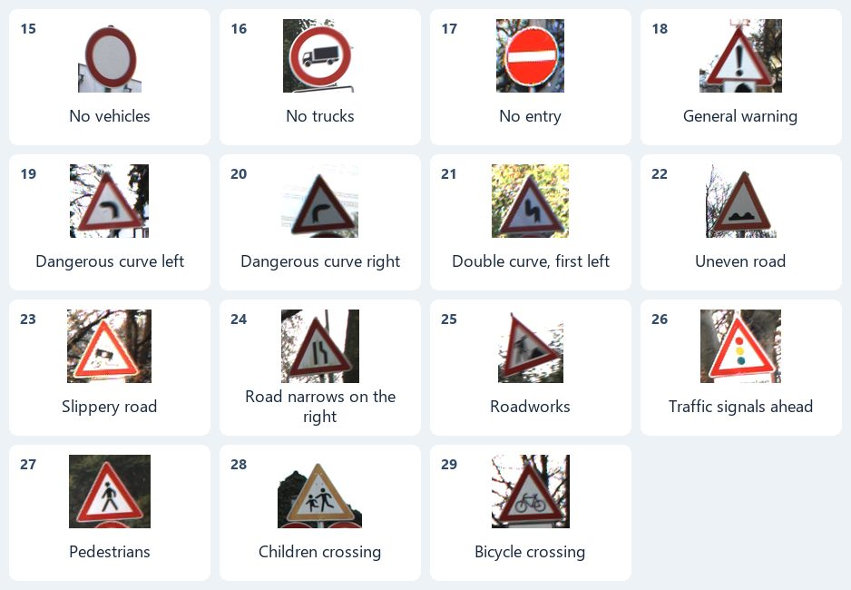
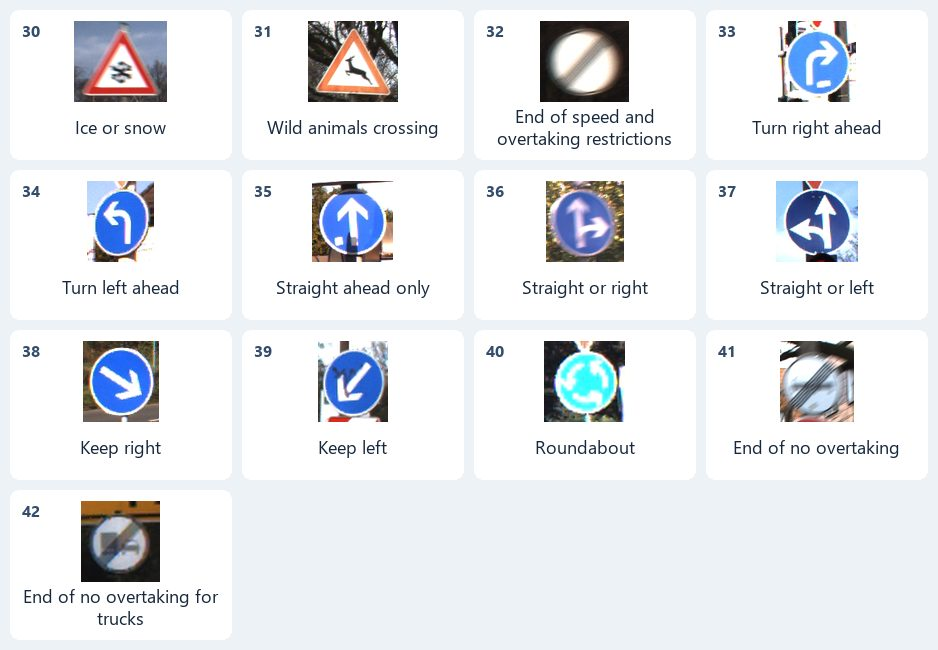

# Traffic Sign Classification

This project compares a small convolutional neural network trained from scratch with an ImageNet-pretrained ResNet-18 on the German Traffic Sign Recognition Benchmark (GTSRB). Given a cropped RGB photo of a single traffic sign, each model predicts one of 43 class IDs. In the Kaggle run, ResNet-18 achieved **96.33% accuracy** and **93.70% macro-F1** on the official test split.

[Dataset](#dataset) · [Class photo guide](#class-photo-guide) · [Results](#results) · [Reproduce the experiment](#reproduce-the-experiment)

## Dataset

GTSRB contains real photographs of German traffic signs, including speed limits, warnings, and mandatory directions. The images vary in size, lighting, viewing angle, and visibility. Each image has one integer label from `0` to `42`. The annotation CSVs identify each image by filename and give its label in the `ClassId` column. They also provide a region of interest around the sign. This experiment resizes the full supplied crop to 96 × 96 and normalizes its RGB channels.

| Split | Images | Purpose |
| --- | ---: | --- |
| Training | 21,300 | Fit both models |
| Validation | 5,340 | Select each model's best checkpoint by macro-F1 |
| Official test | 12,630 | Evaluate the selected checkpoints |

The counts describe the exact archives and split used in this run. The training archive contains multiple photos of the same physical sign. The project groups those photos by track ID and uses a stratified group split so a track stays entirely in training or validation. The official test set is reserved for final evaluation. [Benchmark paper](https://www.ini.rub.de/upload/file/1470692848_f03494010c16c36bab9e/StallkampEtAl_GTSRB_IJCNN2011.pdf) · [TorchVision dataset loader](https://docs.pytorch.org/vision/stable/generated/torchvision.datasets.GTSRB.html)

## Class photo guide

Each tile shows a real photo from the GTSRB training archive, its numeric class ID, and the sign's meaning. In the confusion matrices, rows are true IDs and columns are predicted IDs.







<details>
<summary>Text index of all 43 labels</summary>

| ID | Label | ID | Label |
| ---: | --- | ---: | --- |
| 0 | Speed limit 20 km/h | 22 | Uneven road |
| 1 | Speed limit 30 km/h | 23 | Slippery road |
| 2 | Speed limit 50 km/h | 24 | Road narrows on the right |
| 3 | Speed limit 60 km/h | 25 | Roadworks |
| 4 | Speed limit 70 km/h | 26 | Traffic signals ahead |
| 5 | Speed limit 80 km/h | 27 | Pedestrians |
| 6 | End of 80 km/h limit | 28 | Children crossing |
| 7 | Speed limit 100 km/h | 29 | Bicycle crossing |
| 8 | Speed limit 120 km/h | 30 | Ice or snow |
| 9 | No overtaking | 31 | Wild animals crossing |
| 10 | No overtaking for trucks | 32 | End of speed and overtaking restrictions |
| 11 | Priority at next intersection | 33 | Turn right ahead |
| 12 | Priority road | 34 | Turn left ahead |
| 13 | Give way | 35 | Straight ahead only |
| 14 | Stop | 36 | Straight or right |
| 15 | No vehicles | 37 | Straight or left |
| 16 | No trucks | 38 | Keep right |
| 17 | No entry | 39 | Keep left |
| 18 | General warning | 40 | Roundabout |
| 19 | Dangerous curve left | 41 | End of no overtaking |
| 20 | Dangerous curve right | 42 | End of no overtaking for trucks |
| 21 | Double curve, first left |  |  |

</details>

## Results

Both models used the same splits, preprocessing, and five-epoch training budget. The run used a **Tesla T4**, batch size **64**, and seed **42**.

| Model | Validation macro-F1 | Test accuracy | Test macro-F1 | Median epoch |
| --- | ---: | ---: | ---: | ---: |
| CNN from scratch | 51.28% | 68.50% | 57.13% | 23.29 s |
| Pretrained ResNet-18 | 84.87% | **96.33%** | **93.70%** | 30.25 s |

Macro-F1 averages the per-class F1 scores with equal weight. ResNet-18 gained **36.57 percentage points** in test macro-F1 and classified **12,167** test images correctly versus **8,652** for the CNN. Its most frequent error was predicting 80 km/h for a 60 km/h sign (40 images). The CNN most often predicted 120 km/h for an 80 km/h sign (149 images).

Epoch times include training and validation. This single-seed run compares two model architectures and training recipes, including different learning rates. Measuring the effect of ImageNet initialization alone would require training the same ResNet-18 with and without pretrained weights under otherwise identical conditions.

[Run metrics](results/kaggle-gtsrb-b18ad576/metrics.json) · [CNN confusion matrix](results/kaggle-gtsrb-b18ad576/cnn_confusion.csv) · [ResNet-18 confusion matrix](results/kaggle-gtsrb-b18ad576/resnet18_confusion.csv)

## Reproduce the experiment

Use Python 3.10 or newer with compatible PyTorch and TorchVision builds. Install the dependencies and run the training script from the repository root.

```bash
python -m pip install -r requirements.txt
python train.py --epochs 5 --batch-size 64 --output runs/baseline
```

For Kaggle or Colab, open [the notebook](traffic_signs.ipynb), make [`train.py`](train.py) available in the runtime, and select a GPU. The first run needs internet access to download GTSRB and the pretrained weights. Each run needs a new output directory and writes the best checkpoint for each model, a metrics JSON file, and two confusion matrices.

## Dataset credit

GTSRB was introduced by Johannes Stallkamp, Marc Schlipsing, Jan Salmen, and Christian Igel at IJCNN 2011. The class guide uses cropped sign photographs from the benchmark's training archive. [Dataset page](https://benchmark.ini.rub.de/gtsrb_dataset.html) · [Benchmark paper](https://www.ini.rub.de/upload/file/1470692848_f03494010c16c36bab9e/StallkampEtAl_GTSRB_IJCNN2011.pdf)
